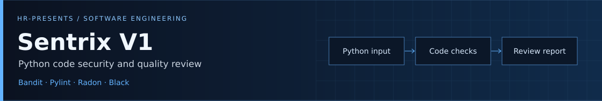
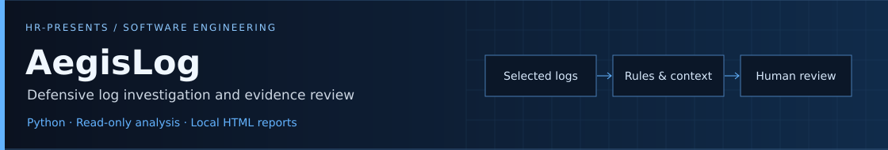
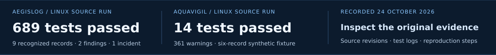

# Haziq Afzal

**Co-Founder & CTO, HR-Presents** · **Udemy Instructor** · **AIOPS Level 6 Student**

Python applications · Defensive security · Linux systems · DevOps & observability

Abu Dhabi, UAE

[Projects](#selected-engineering-work) · [Evidence](#engineering-evidence) · [Toolbox](#technical-toolkit) · [Teaching](#building-together--teaching) · [Background](#background)

---

I work on tools for checking Python code, investigating logs and automating Linux tasks. I develop software with Ruveeha at HR-Presents while continuing my AIOPS studies; the projects below show the work and its limits.

## Selected engineering work

Ruveeha and I jointly develop Sentrix, combining Bandit, Pylint, Radon and Black in one application. Our shared work includes implementation, testing and release preparation.

**Design choice:** keep security, quality, complexity and formatting results distinct, so a result from one check is not mistaken for an overall verdict.

[Read the product case study →](docs/case-studies/sentrix.md) · Private source

Ruveeha and I jointly develop AegisLog for defensive log investigation and local HTML reporting, including implementation, testing and release preparation.

**Design choice:** preserve source logs and bound retained evidence. Reports disclose coverage and truncation, so investigators can see what the analysis leaves out.

[Read the engineering case study →](docs/case-studies/aegislog.md) · [Repository](https://github.com/HR-Presents/AegisLog) · [Recorded tests](docs/verification/2026-10-24/README.md)

### Systems, labs and automation

| Project | Work and contribution | Explore |
| :--- | :--- | :--- |
| **AquaVigil** | Educational water/process and OT evidence analysis with Prometheus and Grafana observability | [Case study](docs/case-studies/aquavigil.md) · [Repository](https://github.com/HaziqBinAfzal/AquaVigil) |
| **LinuxOps Enterprise Lab** | Haziq’s Ubuntu baseline and service-health checks; Ruveeha’s Rocky Linux work is separately credited. Phase 01 complete; Phases 02–10 planned | [Haziq’s original evidence](docs/demo-gallery.md#haziq--ubuntu-baseline) · [Lab](https://github.com/HaziqBinAfzal/linuxops-enterprise-lab) |
| **AI Log Analyzer** | Collaborative Flask dashboard; Haziq contributed frontend UI and API integration | [Contribution details](docs/professional-background.md#additional-github-work) · [Repository](https://github.com/HaziqBinAfzal/AI-Log-Analyzer) |
| **Linux Backup & Recovery** | Documented backup and restoration using rsync, tar, GPG, SHA256, SSH and cron | [Workflow and team credits](docs/professional-background.md#enterprise-linux-backup--recovery-system) · [Repository](https://github.com/HaziqBinAfzal/linux-backup-recovery-system) |
| **Jira Python Automation** | Collaborative Python REST API project for issue creation and workflow automation | [Repository](https://github.com/HaziqBinAfzal/jira-python-automation-bot) |

## Engineering evidence

[Test logs, reports and reproduction steps](docs/verification/2026-10-24/README.md) · [Demo gallery](docs/demo-gallery.md)

**Linux lab evidence:** [Haziq’s Ubuntu baseline](docs/demo-gallery.md#haziq--ubuntu-baseline) · [Ruveeha’s Rocky Linux memory incident](https://github.com/HaziqBinAfzal/linuxops-enterprise-lab/blob/main/phases/phase-01/docs/memory-troubleshooting.md), approximately 609 MiB before and 3.6 GiB after the change/restart.

These are dated synthetic Linux source runs, not evidence of production performance, detection accuracy, or Windows/Docker acceptance. AquaVigil’s six-record scenario returned Critical status and risk score 100; that is application output, not measured detection accuracy.

**More work:** [SFVDS](https://github.com/HaziqBinAfzal/sfvds) · [Jira Python Automation](https://github.com/HaziqBinAfzal/jira-python-automation-bot) · [Smart Mount Manager](https://github.com/HaziqBinAfzal/Smart_Mount_Manager)  
**Learning forks:** [AWS](https://github.com/HaziqBinAfzal/aws-devops-zero-to-hero) · [Terraform](https://github.com/HaziqBinAfzal/terraform-zero-to-hero)

---

## Technical toolkit

**Project-facing stack:** Python · Flask · Bash · Linux · Git · Docker · GitHub Actions · Prometheus · Grafana

**Practices:** Defensive investigation · CI/CD · Reproducible tests · Evidence review · Backup and recovery

<strong>Explore tools, platforms and ongoing studies</strong>

### Programming & automation

### Linux & cloud

### DevOps & observability

### Security & investigation

### AI & ongoing studies

Tools used in projects and labs, alongside subjects I am studying. [Skills and learning context](docs/professional-background.md#technical-skills-listed-on-linkedin).

---

## Building together & teaching

I co-founded **[HR-Presents](https://github.com/HR-Presents)** with **Ruveeha Ashfaq, Co-Founder & CEO**. We develop software and create technical courses together, sharing product ownership and contributor credit. Ruveeha: [GitHub](https://github.com/ruveeha33) · [LinkedIn](https://www.linkedin.com/in/ruveeha-ashfaq/).

### Our Udemy courses

Co-created and presented by **Haziq Afzal and Ruveeha Ashfaq** under HR-Presents.

| Course | What it covers |
| :--- | :--- |
| **[Docker Pro Skills: Build, Secure & Deploy Applications](https://www.udemy.com/course/docker-mastery-from-beginner-to-job-ready/)** | Dockerfiles, Compose, networking, security, troubleshooting, CI/CD, an e-commerce capstone and introductory Kubernetes |
| **[Think Before You Click: The Online Safety Course](https://www.udemy.com/course/think-before-you-click-the-online-safety-course/)** | Scams, phishing, account protection, privacy and safer everyday digital decisions |

Our shared work includes curriculum, demonstrations, recording, quizzes, presentations and downloadable practice resources.

## Development activity

*Activity snapshots provide context, not a measure of engineering quality.*

Dated snapshot of GitHub’s displayed calendar through 24 October 2026; October is partial. [Source counts](contribution-data.json). See GitHub’s contribution calendar below for current activity.

---

## Background

<strong>Experience, education and professional introduction</strong>

I build software, investigate system behavior and document what the evidence supports. My experience comes from study, hands-on labs and collaborative projects across Python, Linux, security, cloud and DevOps.

At [HR-Presents](https://github.com/HR-Presents), I work with [Ruveeha Ashfaq](https://github.com/ruveeha33), Co-Founder & CEO, on software products and technical education. We share product ownership and credit throughout planning, development, testing, documentation and releases.

### Experience

| Role | Since | Work |
| :--- | :--- | :--- |
| **Co-Founder & CTO — HR-Presents** | Aug 2026 | Joint product development, testing, troubleshooting, documentation and release preparation |
| **Udemy Instructor** | Sep 2026 | Two published courses co-created with Ruveeha |
| **Student Member — Al Nafi International College** | Aug 2026 | Structured learning and lab exercises across Linux, cloud, security and automation |

### Education & training

| Program | Institution | Status |
| :--- | :--- | :--- |
| **AIOPS Level 6 — Artificial Intelligence** | Al Nafi International College | In progress · Aug 2025–Feb 2027 expected |
| **Diploma in Cloud Cyber Security (RQF 3)** | Al Nafi International College · EduQual Level 3 | Completed · Jun–Aug 2024 · Grade B |

### Skills & practical capabilities

| Area | Skills |
| :--- | :--- |
| **Security** | Cybersecurity · Cloud Security |
| **Linux systems** | Linux · Red Hat Linux · CentOS |
| **Programming & tooling** | Python · Bash · Git · Jira |
| **DevOps & delivery** | DevOps · Docker · Continuous Integration and Continuous Delivery (CI/CD) |
| **Observability** | Prometheus · Grafana |
| **AI & analysis** | Artificial Intelligence · Machine Learning · Anomaly Detection |

The projects above connect these skills to inspectable work. AI topics also form part of ongoing studies. [Full skills and learning context](docs/professional-background.md#technical-skills-listed-on-linkedin).

## Credentials

<strong>View credentials, training badge and languages</strong>

| Credential | Issuer | Issued | Verify |
| :--- | :--- | :--- | :--- |
| **AWS Knowledge: Amazon ECS Trained** | Amazon Web Services (AWS) | Sep 2026 | [Credly training badge](https://www.credly.com/badges/1a9facfe-2f4e-4ab0-b9c2-70d6cd7904f9/public_url) |

**Languages:** English — professional working proficiency · Urdu — native or bilingual proficiency.

## Contact & opportunities

I am open to opportunities in **Python engineering, Linux administration, security tooling and DevOps**, particularly work that values clear documentation, reproducible testing and collaborative delivery.

[Full professional background](docs/professional-background.md) · [Project credits](docs/professional-background.md#project-contributions-and-credits) · [LinkedIn](https://www.linkedin.com/in/haziq-afzal/) · [HR-Presents](https://www.linkedin.com/company/hr-presents/)

---

[LinkedIn](https://www.linkedin.com/in/haziq-afzal/) · [HR-Presents](https://github.com/HR-Presents) · [Project credits](docs/professional-background.md#project-contributions-and-credits)
