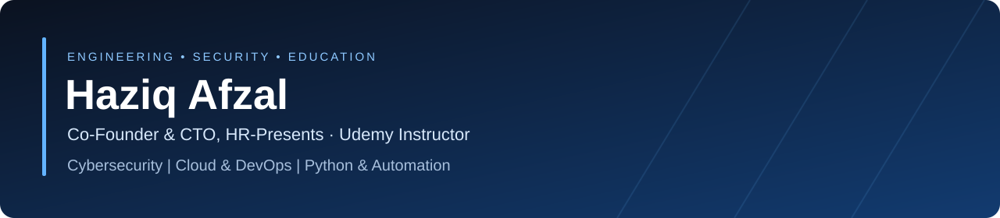

# Haziq Afzal

### Co-Founder & CTO, HR-Presents | Software Engineering • Cybersecurity • Cloud & DevOps

**Building secure software, reliable infrastructure, and practical automation.**

---

## About me

I'm **Haziq Afzal**, Co-Founder & CTO of **HR-Presents** and a Udemy instructor. My work spans **cybersecurity, Python development, cloud and DevOps, Linux infrastructure, and automation**.

I enjoy building tools that solve practical engineering problems, from code security analysis and operational evidence to monitoring and infrastructure workflows. I work alongside **[Ruveeha Ashfaq](https://github.com/ruveeha33)**, Co-Founder & CEO of HR-Presents, on software products and technical education.

I approach projects with an emphasis on **security, reproducibility, useful documentation, and operational clarity**.

## Areas of focus

| Domain | What I work on |
| :--- | :--- |
| **Security engineering** | Secure development, code analysis, threat detection concepts and evidence-driven reviews |
| **Cloud & DevOps** | Docker, CI/CD workflows, GitHub Actions and infrastructure practice |
| **Linux & systems** | Linux administration, troubleshooting, backups and recovery |
| **Python & automation** | Developer tools, operational automation and integrations |
| **Observability** | Prometheus, Grafana, logging and monitoring workflows |
| **Technical education** | Practical training and cybersecurity awareness |

## Technology toolkit

**Languages & systems**

**Infrastructure, delivery & monitoring**

## Featured engineering work

| Project | Focus |
| :--- | :--- |
| **[Sentrix V1](https://github.com/HR-Presents/HR-Presents-Sentrix)** | Python code security and quality analysis using Bandit, Pylint, Radon and Black; reporting and developer workflows. Source repository is private. |
| **[AegisLog](https://github.com/HR-Presents/AegisLog)** | Read-only defensive log analysis and investigation with local HTML reports |
| **[AquaVigil](https://github.com/HaziqBinAfzal/AquaVigil)** | Read-only water and desalination security decision support, monitoring and process evidence |
| **[LinuxOps Enterprise Lab](https://github.com/HaziqBinAfzal/linuxops-enterprise-lab)** | Collaborative, phased Linux systems engineering lab with documented implementation and evidence |
| **[AI Log Analyzer](https://github.com/HaziqBinAfzal/AI-Log-Analyzer)** | Log analysis and automation experimentation |
| **[Linux Backup & Recovery](https://github.com/HaziqBinAfzal/linux-backup-recovery-system)** | Linux backup and recovery using rsync, GPG, SSH, SHA256 and cron |

### More infrastructure projects

[Jira Python Automation Bot](https://github.com/HaziqBinAfzal/jira-python-automation-bot) · [Smart Mount Manager](https://github.com/HaziqBinAfzal/Smart_Mount_Manager) · [AWS DevOps Practice](https://github.com/HaziqBinAfzal/aws-devops-zero-to-hero) · [Terraform Practice](https://github.com/HaziqBinAfzal/terraform-zero-to-hero)

## GitHub activity

> Activity cards are provided by an external service and may occasionally be unavailable. GitHub’s own contribution graph remains the authoritative activity record.

## Collaboration & teaching

At **[HR-Presents](https://github.com/HR-Presents)**, I collaborate on practical software and cybersecurity education. My work combines technical implementation with documentation and learning resources designed to make complex topics approachable.

### Building together at HR-Presents

I co-founded HR-Presents with **[Ruveeha Ashfaq](https://github.com/ruveeha33), Co-Founder & CEO and Udemy Instructor**. We collaborate on software products, technical learning resources and course development.

**Connect with Ruveeha:** [GitHub](https://github.com/ruveeha33) · [LinkedIn](https://www.linkedin.com/in/ruveeha-ashfaq/)

### Our Udemy courses

Co-created and presented by **Haziq Afzal and Ruveeha Ashfaq** under HR-Presents.

| Course | What it covers |
| :--- | :--- |
| **[Docker Pro Skills: Build, Secure & Deploy Applications](https://www.udemy.com/course/docker-mastery-from-beginner-to-job-ready/)** | Docker fundamentals, Dockerfiles, image optimization, Compose, networking, security, troubleshooting, NGINX, Swarm, CI/CD and an e-commerce capstone, with introductory Kubernetes concepts |
| **[Think Before You Click: The Online Safety Course](https://www.udemy.com/course/think-before-you-click-the-online-safety-course/)** | Practical cybersecurity awareness, scam recognition, account protection and safer everyday online decisions |

My teaching interests connect software engineering with practical cybersecurity awareness and infrastructure skills.

**Explore:** [GitHub repositories](https://github.com/HaziqBinAfzal?tab=repositories) · [HR-Presents projects](https://github.com/HR-Presents) · [LinkedIn](https://www.linkedin.com/in/haziq-afzal/)

---

Secure by design. Clear in execution. Built to be useful.

