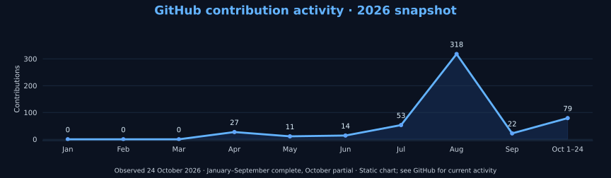

# Haziq Afzal

Abu Dhabi, UAE · AIOPS Level 6 student

[Engineering Focus](#engineering-focus) · [Projects](#featured-engineering-work) · [Evidence](#evidence-at-a-glance) · [Technical Toolkit](#technical-toolkit) · [Courses](#our-udemy-courses) · [Background](#background) · [Credentials](#credentials)

---

Python, Linux and defensive security projects, built through study, hands-on labs and collaboration.

## Engineering focus

I build practical software and infrastructure projects across **Python, cybersecurity, Linux, cloud and DevOps**.

My work emphasizes reproducible testing, defensive security, automation, clear documentation and evidence-backed engineering.

| Software Engineering | Security & Infrastructure | Delivery & Observability |
| :--- | :--- | :--- |
| Python · Flask · REST APIs | Linux · SSH · Defensive Security | Docker · GitHub Actions |
| Automation · Code Quality | Log Analysis · Backup & Recovery | CI/CD · Prometheus · Grafana |

[Explore my projects](#featured-engineering-work) · [View engineering evidence](#evidence-at-a-glance) · [Connect on LinkedIn](https://www.linkedin.com/in/haziq-afzal/)

---
## Featured engineering work

### 01 / Flagship software

**Sentrix V1 — Python Code Security & Quality Analyzer**

A collaborative HR-Presents product combining **Bandit, Pylint, Radon and Black** for Python security, code quality, complexity and formatting analysis.

[Explore the product](docs/case-studies/sentrix.md)

---

### 02 / Defensive security engineering

**AegisLog — Defensive Log Investigation**

Read-only investigation of security logs, with evidence review and local HTML reporting.

[View repository](https://github.com/HR-Presents/AegisLog) · [Read case study](docs/case-studies/aegislog.md) · [Explore demo](https://github.com/HR-Presents/AegisLog/tree/main/docs/demo)

---

### 03 / Infrastructure, automation & applied security

<table>
<tr>
<td width="50%" valign="top">

<strong>AquaVigil</strong>

Educational water/process and OT evidence analysis with Prometheus and Grafana observability.

<a href="docs/case-studies/aquavigil.md">Case study</a>
</td>
<td width="50%" valign="top">

<strong>AI Log Analyzer</strong>

Collaborative Flask log-analysis dashboard. Haziq contributed frontend UI and API integration.

<a href="docs/professional-background.md#additional-github-work">Contributor responsibilities</a>
</td>
</tr>
<tr>
<td width="50%" valign="top">

<strong>Linux Backup & Recovery</strong>

Documented backup and restoration using rsync, tar, GPG, SHA256, SSH and cron.

<a href="docs/professional-background.md#enterprise-linux-backup--recovery-system">Workflow and team credits</a>
</td>
<td width="50%" valign="top">

<strong>Jira Python Automation</strong>

Collaborative Python REST API project for issue creation and workflow automation.

<a href="https://github.com/HaziqBinAfzal/jira-python-automation-bot">Repository</a>
</td>
</tr>
</table>

**[Open the demo gallery →](docs/demo-gallery.md)** Original lab screenshots, guided demonstrations and implementation evidence.

### Evidence at a glance

| Review | What the retained record shows |
| :--- | :--- |
| **AegisLog synthetic investigation** | [Fresh v2.1.17 source run](docs/verification/2026-10-24/README.md): 9 recognized records, 2 findings, 1 incident; **689 tests passed** |
| **LinuxOps memory troubleshooting** | Ruveeha's [incident record](https://github.com/HaziqBinAfzal/linuxops-enterprise-lab/blob/main/phases/phase-01/docs/memory-troubleshooting.md) shows approximately 609 MiB before and 3.6 GiB after the change/restart |
| **AquaVigil scenario** | [Fresh source run](docs/verification/2026-10-24/README.md): 6 synthetic records, Critical status, risk score 100; **14 tests passed** |

[Inspect test logs, generated reports and the reproducible streaming benchmark](docs/verification/2026-10-24/README.md). These synthetic Linux runs do not establish production performance, detection accuracy or Windows/Docker acceptance.

**More work:** [SFVDS](https://github.com/HaziqBinAfzal/sfvds) · [Jira Python Automation](https://github.com/HaziqBinAfzal/jira-python-automation-bot) · [Smart Mount Manager](https://github.com/HaziqBinAfzal/Smart_Mount_Manager)  
**Learning forks:** [AWS](https://github.com/HaziqBinAfzal/aws-devops-zero-to-hero) · [Terraform](https://github.com/HaziqBinAfzal/terraform-zero-to-hero)

## Technical toolkit

**Programming & automation**

**Linux & cloud**

**DevOps & observability**

**Security & investigation**

**AI & ongoing studies**

Tools used across my projects and labs, alongside topics I’m studying. [Skills and learning context](docs/professional-background.md#technical-skills-listed-on-linkedin).

## Building together & teaching

**Ruveeha Ashfaq — Co-Founder & CEO, HR-Presents · Udemy Instructor**  
[GitHub](https://github.com/ruveeha33) · [LinkedIn](https://www.linkedin.com/in/ruveeha-ashfaq/)

### Our Udemy courses

Co-created and presented by **Haziq Afzal and Ruveeha Ashfaq** under HR-Presents.

<table>
<tr>
<td width="50%" valign="top">
Dockerfiles, Compose, networking, security, troubleshooting, CI/CD and an e-commerce capstone; introductory Kubernetes
</td>
<td width="50%" valign="top">
Scams, phishing, account protection, privacy and safer everyday digital decisions
</td>
</tr>
</table>

Our shared work includes curriculum, demonstrations, recording, quizzes, presentations and downloadable practice resources.

## Development activity

Contribution chart: dated snapshot of GitHub’s displayed calendar, with October partial; click for the source counts. Statistics and language cards use external services. Language distribution can include documentation and learning repositories and does not measure proficiency. See GitHub’s contribution calendar below for current activity.

## Background

<strong>Experience, education &amp; professional introduction</strong>

I build software, investigate system behavior and document what the evidence supports. My experience comes from **study, hands-on labs and collaborative projects** across Python, Linux, security, cloud and DevOps.

At **[HR-Presents](https://github.com/HR-Presents)**, I work with **[Ruveeha Ashfaq](https://github.com/ruveeha33), Co-Founder & CEO**, on software products and technical education. We share product ownership and credit throughout planning, development, testing, documentation and releases.

## Experience

| Role | Since | Work |
| :--- | :--- | :--- |
| **Co-Founder & CTO — HR-Presents** | Aug 2026 | Joint product development, testing, troubleshooting, documentation and release preparation |
| **Udemy Instructor** | Sep 2026 | Two published courses co-created with Ruveeha |
| **Student Member — Al Nafi International College** | Aug 2026 | Structured learning and lab exercises across Linux, cloud, security and automation |

## Education & training

| Program | Institution | Status |
| :--- | :--- | :--- |
| **AIOPS Level 6 — Artificial Intelligence** | Al Nafi International College | In progress · Aug 2025–Feb 2027 expected |
| **Diploma in Cloud Cyber Security (RQF 3)** | Al Nafi International College · EduQual Level 3 | Completed · Jun–Aug 2024 · Grade B |

## Skills & practical capabilities

| Area | Skills |
| :--- | :--- |
| **Security** | Cybersecurity · Cloud Security |
| **Linux systems** | Linux · Red Hat Linux · CentOS |
| **Programming & tooling** | Python · Bash · Git · Jira |
| **DevOps & delivery** | DevOps · Docker · Continuous Integration and Continuous Delivery (CI/CD) |
| **Observability** | Prometheus · Grafana |
| **AI & analysis** | Artificial Intelligence · Machine Learning · Anomaly Detection |

The projects above connect these skills to inspectable work. AI topics also form part of my ongoing studies. [Full skills and learning context](docs/professional-background.md#technical-skills-listed-on-linkedin).

## Credentials

<strong>View credentials, training badge &amp; languages</strong>

| Credential | Issuer | Issued | Verify |
| :--- | :--- | :--- | :--- |
| **AWS Knowledge: Amazon ECS Trained** | Amazon Web Services (AWS) | Sep 2026 | [Credly training badge](https://www.credly.com/badges/1a9facfe-2f4e-4ab0-b9c2-70d6cd7904f9/public_url) |

**Languages:** English — professional working proficiency · Urdu — native or bilingual proficiency.

## Contact & opportunities

I welcome opportunities to contribute, gain professional experience and build useful technology with others.

[Full professional background](docs/professional-background.md) · [Project credits](docs/professional-background.md#project-contributions-and-credits) · [LinkedIn](https://www.linkedin.com/in/haziq-afzal/) · [HR-Presents](https://www.linkedin.com/company/hr-presents/)

---

<a href="#featured-engineering-work">Explore engineering work</a> · <a href="https://www.linkedin.com/in/haziq-afzal/">Connect on LinkedIn</a> · <a href="#our-udemy-courses">View courses</a>

