

# Haziq Afzal

Python applications · Defensive security · Linux systems · DevOps & observability

Abu Dhabi, UAE · AIOPS Level 6 student

[Projects](#featured-engineering-work) · [Demo gallery](docs/demo-gallery.md) · [Tech stack](#-tech-stack) · [Courses](#our-udemy-courses) · [Credentials](#credentials) · [Background](#background)

I work on tools for checking Python code, investigating logs and automating Linux tasks. I develop software with Ruveeha at HR-Presents while continuing my AIOPS studies; the projects below show the work and its limits.

## Featured engineering work

<table>
<tr>
<td width="50%" valign="top">
<a href="docs/case-studies/sentrix.md">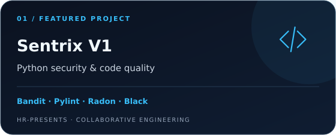</a>

Joint HR-Presents product combining Bandit, Pylint, Radon, Black and syntax checks, with separate security and code-quality results.

<a href="docs/case-studies/sentrix.md"><strong>Product case study →</strong></a> · Private source

</td>
<td width="50%" valign="top">
<a href="https://github.com/HR-Presents/AegisLog">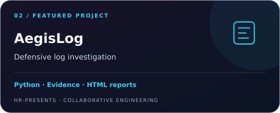</a>

Joint defensive log investigation product with source-preserving analysis, bounded evidence review and local HTML reports.

<a href="docs/case-studies/aegislog.md"><strong>Engineering case study →</strong></a> · <a href="https://github.com/HR-Presents/AegisLog">Repository</a> · <a href="docs/verification/2026-10-24/README.md">Test evidence</a>

</td>
</tr>
<tr>
<td width="50%" valign="top">
<a href="https://github.com/HaziqBinAfzal/AquaVigil">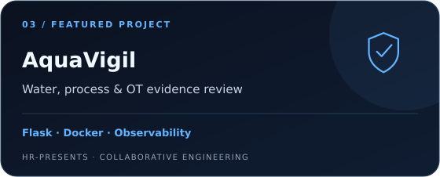</a>

Educational water/process and OT evidence analysis with Prometheus and Grafana observability.

<a href="docs/case-studies/aquavigil.md">Case study →</a>
</td>
<td width="50%" valign="top">
<a href="https://github.com/HaziqBinAfzal/AI-Log-Analyzer">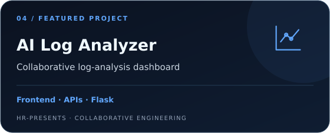</a>

Built the <strong>frontend UI and API integration</strong>; Ruveeha contributed the Flask backend and Ambreen contributed classification logic.

<a href="docs/professional-background.md#additional-github-work">Contribution details →</a>
</td>
</tr>
<tr>
<td width="50%" valign="top">
<a href="https://github.com/HaziqBinAfzal/linux-backup-recovery-system">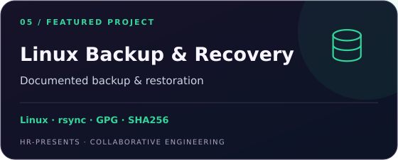</a>

Documented backup and restoration using rsync, tar, GPG, SHA256, SSH and cron.

<a href="docs/professional-background.md#enterprise-linux-backup--recovery-system">Workflow and team credits →</a>
</td>
<td width="50%" valign="top">
<a href="https://github.com/HaziqBinAfzal/jira-python-automation-bot">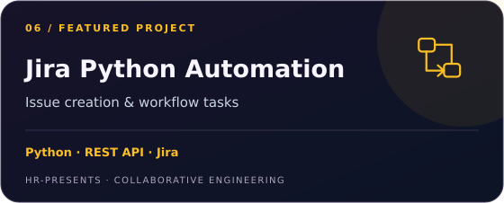</a>

Collaborative Python REST API project for issue creation and workflow automation.

<a href="https://github.com/HaziqBinAfzal/jira-python-automation-bot">Repository →</a>
</td>
</tr>
</table>

**[Open the demo gallery →](docs/demo-gallery.md)** Project context, original evidence, contributor roles and operating limits.

Dated synthetic Linux source runs; test logs, limitations and benchmark conditions are retained in the linked verification record.

**More work:** [LinuxOps Enterprise Lab](https://github.com/HaziqBinAfzal/linuxops-enterprise-lab) · [Ubuntu baseline evidence](docs/demo-gallery.md#haziq--ubuntu-baseline) · [SFVDS](https://github.com/HaziqBinAfzal/sfvds) · [Jira Python Automation](https://github.com/HaziqBinAfzal/jira-python-automation-bot) · [Smart Mount Manager](https://github.com/HaziqBinAfzal/Smart_Mount_Manager)  
**Learning forks:** [AWS](https://github.com/HaziqBinAfzal/aws-devops-zero-to-hero) · [Terraform](https://github.com/HaziqBinAfzal/terraform-zero-to-hero)

## 💻 Tech Stack

**Programming & automation**

**Linux & cloud**

**DevOps & observability**

**Security & investigation**

**AI & ongoing studies**

Tools used in projects and labs, alongside subjects I am studying. [Skills and learning context](docs/professional-background.md#technical-skills-listed-on-linkedin).

## Building together & teaching

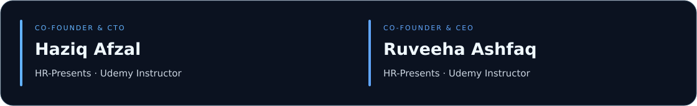

I collaborate with **Ruveeha Ashfaq — Co-Founder & CEO, HR-Presents and Udemy Instructor**. [GitHub](https://github.com/ruveeha33) · [LinkedIn](https://www.linkedin.com/in/ruveeha-ashfaq/)

### Our Udemy courses

Co-created and presented by **Haziq Afzal and Ruveeha Ashfaq** under HR-Presents.

<table>
<tr>
<td width="50%" valign="top"><a href="https://www.udemy.com/course/docker-mastery-from-beginner-to-job-ready/">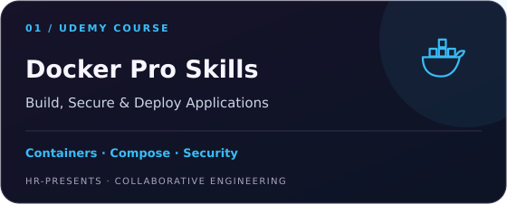</a>
Dockerfiles, Compose, networking, security, troubleshooting, CI/CD, an e-commerce capstone and introductory Kubernetes.
</td>
<td width="50%" valign="top"><a href="https://www.udemy.com/course/think-before-you-click-the-online-safety-course/">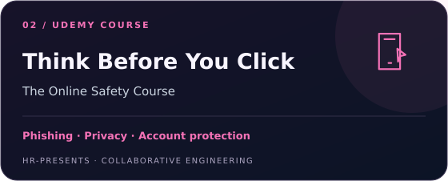</a>
Scams, phishing, account protection, privacy and safer everyday digital decisions.
</td>
</tr>
</table>

Our shared work includes curriculum, demonstrations, recording, quizzes, presentations and downloadable practice resources.

## Development graph

*Activity snapshots provide context, not a measure of engineering quality.*

<a href="./assets/dynamic/data.json">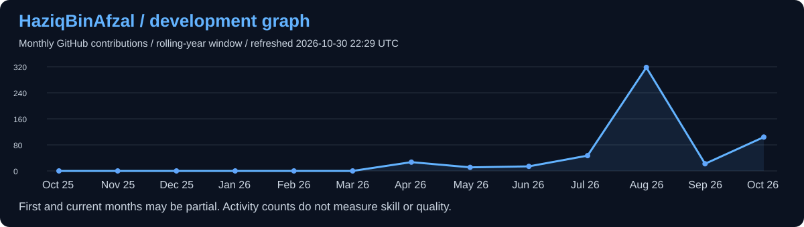</a>

Automatically refreshed every six hours. Cards show the last successful refresh time. Public non-fork language share is not a proficiency score. Historical verification retains its date.

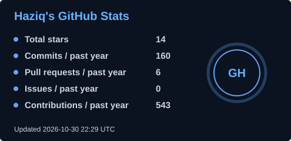
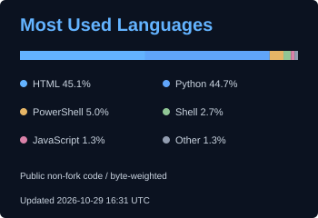

## Background

<strong>Experience, education and professional introduction</strong>

I build software, investigate system behavior and document what the evidence supports. My experience comes from study, hands-on labs and collaborative projects across Python, Linux, security, cloud and DevOps.

At [HR-Presents](https://github.com/HR-Presents), I work with [Ruveeha Ashfaq](https://github.com/ruveeha33), Co-Founder & CEO, on software products and technical education. We share product ownership and credit throughout planning, development, testing, documentation and releases.

### Experience

| Role | Since | Work |
| :--- | :--- | :--- |
| **Co-Founder & CTO — HR-Presents** | Aug 2026 | Joint product development, testing, troubleshooting, documentation and release preparation |
| **Udemy Instructor** | Sep 2026 | Two published courses co-created with Ruveeha |
| **Student Member — Al Nafi International College** | Aug 2026 | Structured learning and lab exercises across Linux, cloud, security and automation |

### Education & training

| Program | Institution | Status |
| :--- | :--- | :--- |
| **AIOPS Level 6 — Artificial Intelligence** | Al Nafi International College | In progress · Aug 2025–Feb 2027 expected |
| **Diploma in Cloud Cyber Security (RQF 3)** | Al Nafi International College · EduQual Level 3 | Completed · Jun–Aug 2024 · Grade B |

### Skills & practical capabilities

| Area | Skills |
| :--- | :--- |
| **Security** | Cybersecurity · Cloud Security |
| **Linux systems** | Linux · Red Hat Linux · CentOS |
| **Programming & tooling** | Python · Bash · Git · Jira |
| **DevOps & delivery** | DevOps · Docker · Continuous Integration and Continuous Delivery (CI/CD) |
| **Observability** | Prometheus · Grafana |
| **AI & analysis** | Artificial Intelligence · Machine Learning · Anomaly Detection |

The projects above connect these skills to inspectable work. AI topics also form part of ongoing studies. [Full skills and learning context](docs/professional-background.md#technical-skills-listed-on-linkedin).

## Credentials

<strong>View credentials, training badge and languages</strong>

| Credential | Issuer | Issued | Verify |
| :--- | :--- | :--- | :--- |
| **AWS Knowledge: Amazon ECS Trained** | Amazon Web Services (AWS) | Sep 2026 | [Credly training badge](https://www.credly.com/badges/1a9facfe-2f4e-4ab0-b9c2-70d6cd7904f9/public_url) |

**Languages:** English — professional working proficiency · Urdu — native or bilingual proficiency.

## Contact & opportunities

I am open to opportunities in **Python engineering, Linux administration, security tooling and DevOps**, particularly work that values clear documentation, reproducible testing and collaborative delivery.

[Full professional background](docs/professional-background.md) · [Project credits](docs/professional-background.md#project-contributions-and-credits) · [LinkedIn](https://www.linkedin.com/in/haziq-afzal/) · [HR-Presents](https://www.linkedin.com/company/hr-presents/)

---

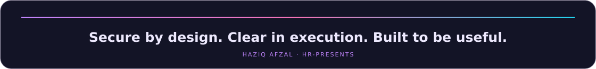

<a href="#featured-engineering-work">Explore engineering work</a> · <a href="https://www.linkedin.com/in/haziq-afzal/">Connect on LinkedIn</a> · <a href="#our-udemy-courses">View courses</a>

