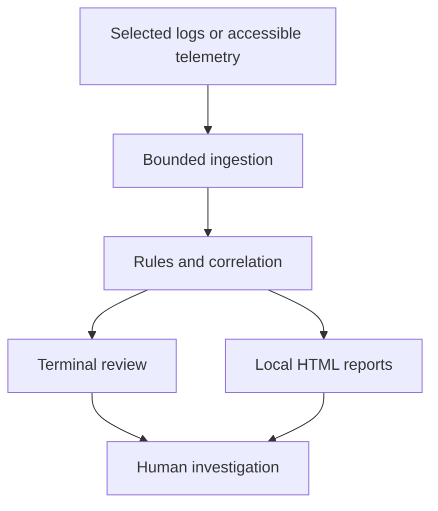

# AegisLog — From raw logs to reviewable evidence

[Profile](../../README.md) · [Demo gallery](../demo-gallery.md) · [Repository](https://github.com/HR-Presents/AegisLog)

**Focus:** Python · defensive investigation · deterministic analysis · local reporting  
**Credits:** Jointly developed by Haziq Afzal and Ruveeha Ashfaq under HR-Presents.

## The problem

Raw logs contain events, repetition and missing context. A useful investigation needs to distinguish raw events from findings, show the evidence behind a lead and preserve the source for further review.

## Our approach and my contribution

Ruveeha and I jointly contribute across planning, implementation, testing, troubleshooting, documentation and release preparation. I present this as shared product development rather than sole authorship.

AegisLog reads supported files or accessible native sources, applies bounded parsing and deterministic rules, groups relevant investigation leads, and presents results through the terminal and local HTML reports.

## Decisions that matter

| Decision | Engineering purpose |
| :--- | :--- |
| Read sources without editing them | Preserve original evidence |
| Separate raw-record, finding and incident counts | Avoid presenting six related failures as six separate findings |
| Disclose recognized formats and collection limits | Make incomplete coverage visible |
| Keep summary and full-evidence reports together | Connect concise review with retained supporting detail |
| Leave response decisions to the investigator | Keep a rule match distinct from proof of an attack |

## Reproducible synthetic demonstration

Use the [demo pack](https://github.com/HR-Presents/AegisLog/tree/main/docs/demo), open AegisLog, select **01 Analyze** and choose `first-investigation.log`. Open Reports to inspect the summary and full evidence. Compare with `clean-baseline.log`.

| Fixture | Records | Recognized | Findings | Incident groups |
| :--- | ---: | ---: | ---: | ---: |
| first-investigation.log | 9 | 9 | 2 | 1 |
| clean-baseline.log | 3 | 3 | 0 | 0 |

The [expected-results manifest](https://github.com/HR-Presents/AegisLog/blob/main/docs/demo/expected-results.json) identifies **validated_version 2.1.11**. These are repository-recorded fixture expectations, not a new execution or a detection-accuracy benchmark. The first case expects one HIGH and one MEDIUM finding. Six authentication failures form one burst finding; the second finding concerns an operational timeout.

The separate built-in seven-record demo has different expected counts. Zero matches on the baseline do not establish that a system is secure.

## Delivered evidence

- [Public v2.1.17 release](https://github.com/HR-Presents/AegisLog/releases/tag/v2.1.17): Windows downloads, a Python wheel and checksums.
- [Beginner walkthrough](https://github.com/HR-Presents/AegisLog/blob/main/docs/QUICKSTART.md): analysis, reports and investigation controls.
- [Demo instructions](https://github.com/HR-Presents/AegisLog/blob/main/docs/demo/README.md): expected behavior and fixture boundaries.
- [Architecture](https://github.com/HR-Presents/AegisLog/blob/main/docs/ARCHITECTURE.md): collection and analysis structure.

## Scope and lessons

Native collection depends on operating system, permissions and source availability. Static fixtures do not generate new live events. The tool supports investigation and does not perform automatic remediation.

The important engineering lesson is to expose how a result was produced: input coverage, rule context, retained evidence and limitations are more useful than an unexplained severity score.
