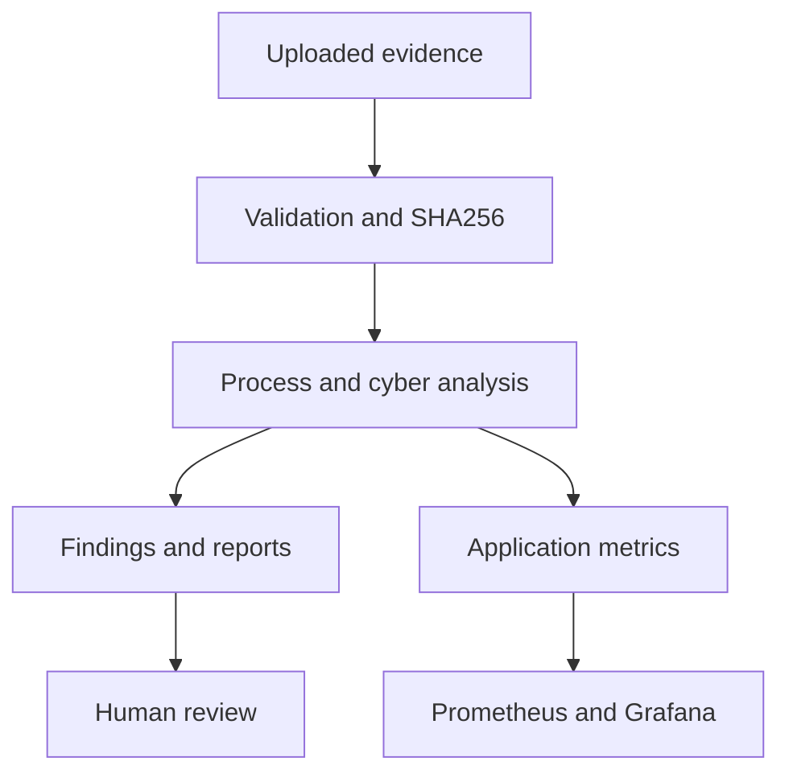

# AquaVigil — Connecting process observations with cyber evidence

[Profile](../../README.md) · [Demo gallery](../demo-gallery.md) · [Repository](https://github.com/HaziqBinAfzal/AquaVigil)

**Focus:** Python · Flask · Docker Compose · evidence provenance · Prometheus · Grafana  
**Credits:** Haziq Afzal — project author; Ruveeha Ashfaq — contributor. Development is collaborative.

## The problem

A water-quality observation and a suspicious network or dosing record can be difficult to interpret in isolation. An educational investigation needs to retain the original evidence, explain the context and distinguish demonstrated analysis from proposed industrial architecture.

## Approach and contribution

I developed AquaVigil collaboratively with Ruveeha as a read-only educational prototype. The repository identifies me as project author and Ruveeha as a contributor.

The application accepts supported CSV/JSON/JSONL evidence, validates and classifies it, calculates SHA256 provenance, correlates supported observations, and produces findings and reports. SQLite retains analysis history. Prometheus and Grafana provide observability.

This summarizes the application workflow. Industrial DMZ and SCADA diagrams in the source describe a design model, not infrastructure provisioned at a real utility.

## A concrete scenario

The bundled [unexpected dosing fixture](https://github.com/HaziqBinAfzal/AquaVigil/blob/main/data/unexpected_dosing_incident.csv) contains six synthetic records.

| UTC time | Dosing record | Authorized | Source zone | Chlorine value |
| :--- | :--- | :--- | :--- | ---: |
| 09:00 | hold | true | OT | 1.1 |
| 09:05 | hold | true | OT | 1.2 |
| 09:10 | increase_chlorine | false | enterprise | 2.8 |
| 09:15 | increase_chlorine | false | enterprise | 4.8 |
| 09:20 | hold | true | OT | 5.3 |
| 09:25 | hold | true | OT | 3.6 |

All rows are dated **19 September 2026**. Values above are copied from the fixture; they are not calibrated plant measurements or results from a fresh run.

The useful investigation question is whether authorization context, source zone and subsequent process readings deserve review together. Temporal association alone does not prove the command caused the process change.

## Walkthrough

1. Start the default Docker Compose stack using the repository launcher or setup instructions.
2. Upload `unexpected_dosing_incident.csv`.
3. Review input classification, provenance, observations and supported findings.
4. Inspect Water Quality and OT/SCADA views, then the report and audit export.
5. Open Prometheus/Grafana after an analysis and explain which metrics they display.

The fixture has six records. Do not promise a next-record flow projection: the documented projection requires at least twelve ordered flow readings.

## Implementation evidence

| Evidence | What it establishes |
| :--- | :--- |
| [Compose file](https://github.com/HaziqBinAfzal/AquaVigil/blob/main/docker-compose.yml) | Default application, Prometheus and Grafana services; optional simulator profile |
| [CI definition](https://github.com/HaziqBinAfzal/AquaVigil/blob/main/.github/workflows/ci.yml) | Configured pytest, compilation, Bandit, dependency audit, model evaluation/manifest steps and container build |
| [Demonstration guide](https://github.com/HaziqBinAfzal/AquaVigil/blob/main/docs/DEMONSTRATION_GUIDE.md) | Review sequence and interpretation limits |
| [Requirement matrix](https://github.com/HaziqBinAfzal/AquaVigil/blob/main/docs/REQUIREMENT_MATRIX.md) | Implemented demonstration versus remaining deployment work |

A workflow definition is evidence of configured checks, not proof that the latest run passed.

## Boundaries and lessons

The prototype sends no industrial-control commands. Zeek/Suricata exports are evidence inputs; live sensors are not installed by the default stack. Synthetic ML screening, heuristic indicators and evidence-to-framework mappings do not establish field validation or regulatory certification.

The core lesson is to make provenance and operational context visible while retaining human authority over interpretation and response.
