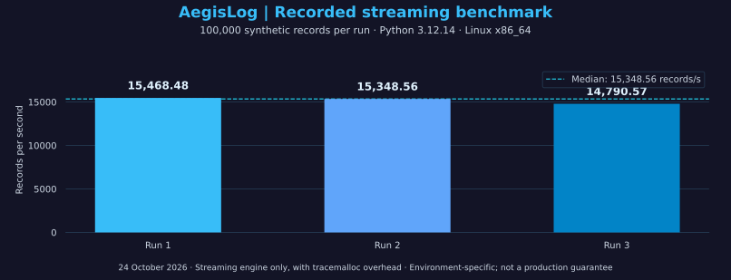

# Engineering Demo Gallery

[Back to profile](../README.md) · [Professional background](professional-background.md)

Explore the problem, the demonstration and the evidence behind each project. Repository material was reviewed on **24 October 2026**. [Fresh Linux source runs, tests and benchmark results](verification/2026-10-24/README.md) are available with exact source commits and reproduction instructions.

## Choose a project

| Project | Start with | What to inspect |
| :--- | :--- | :--- |
| **AegisLog** | [Case study](case-studies/aegislog.md) · [Synthetic demo pack](https://github.com/HR-Presents/AegisLog/tree/main/docs/demo) | Log records, findings, incident grouping and local reports |
| **AquaVigil** | [Case study](case-studies/aquavigil.md) · [Guided walkthrough](https://github.com/HaziqBinAfzal/AquaVigil/blob/main/docs/DEMONSTRATION_GUIDE.md) | Dosing evidence, provenance, process context, reports and observability |
| **LinuxOps Enterprise Lab** | [Case study](case-studies/linuxops.md) · [Phase 01 evidence](https://github.com/HaziqBinAfzal/linuxops-enterprise-lab/blob/main/phases/phase-01/evidence/README.md) | Original baseline and memory-troubleshooting screenshots |
| **Sentrix V1** | [Public case study](case-studies/sentrix.md) · [Product announcement](https://www.linkedin.com/feed/update/urn:li:activity:7518587436281688064/) | Publicly described tool integration, findings and reporting workflow |

## LinuxOps — original lab evidence

These are existing screenshots from the public LinuxOps repository. They are historical lab evidence and remain attributed to the contributor who performed the work.

### Haziq — Ubuntu baseline

The original captures `uptime`, `free -h`, `nproc`, `df -hT` and service-health review. Open the full-size original for small terminal text.

### Ruveeha — memory before the fix

The Rocky guest reports approximately **609 MiB** RAM. The original also records memory-related kernel warnings.

### Ruveeha — memory after the change and restart

The guest reports approximately **3.6 GiB** RAM and **zero failed systemd units**. The [incident report](https://github.com/HaziqBinAfzal/linuxops-enterprise-lab/blob/main/phases/phase-01/docs/memory-troubleshooting.md) explains the Hyper-V change and the limits of the cause assessment.

[All six original screenshots, captions and coverage limits](https://github.com/HaziqBinAfzal/linuxops-enterprise-lab/blob/main/phases/phase-01/evidence/README.md)

## AegisLog — a small, inspectable investigation

The downloadable demo uses fictional accounts, events and documentation-range addresses.

| Demonstration | Repository-recorded expectation |
| :--- | :--- |
| `first-investigation.log` | 9 records, 9 recognized, 2 findings and 1 incident group |
| `clean-baseline.log` | 3 records, 3 recognized, no findings and no incident groups |

The [manifest](https://github.com/HR-Presents/AegisLog/blob/main/docs/demo/expected-results.json) records validation against **2.1.11**. A fresh source run of **2.1.17** confirmed the investigation counts: **9 recognized records, 2 findings and 1 incident**. The suite passed **689 tests**. [Actual outputs and reproduction steps](verification/2026-10-24/README.md). The baseline row above remains the repository-recorded expectation.

**Walkthrough:** open AegisLog → choose **01 Analyze** → select the extracted fixture → open Reports → inspect summary and full evidence → compare the baseline.

[Demo instructions](https://github.com/HR-Presents/AegisLog/blob/main/docs/demo/README.md) · [Release v2.1.17](https://github.com/HR-Presents/AegisLog/releases/tag/v2.1.17) · [Case study](case-studies/aegislog.md)

No reference or unverified UI image is presented here as a released-product screenshot.

### Recorded streaming benchmark

The chart uses the retained [benchmark JSON](verification/2026-10-24/aegislog-benchmark.json). It measures the streaming engine with tracemalloc overhead and excludes report rendering, native collection and live polling. These local synthetic timings are not a production-throughput or detection-accuracy guarantee.

### Recorded streaming benchmark

The chart uses the retained [benchmark JSON](verification/2026-10-24/aegislog-benchmark.json). It measures the streaming engine with tracemalloc overhead and excludes report rendering, native collection and live polling. These local synthetic timings are not a production-throughput or detection-accuracy guarantee.

## AquaVigil — a guided evidence review

**Walkthrough:** start the local Docker Compose stack → upload `unexpected_dosing_incident.csv` → inspect provenance and process/security observations → open the report → inspect Prometheus/Grafana after analysis.

The bundled fixture contains **six synthetic records**, including two unauthorized enterprise-zone `increase_chlorine` records. The [case study](case-studies/aquavigil.md) shows the exact input values and explains how to interpret them.

[Fixture](https://github.com/HaziqBinAfzal/AquaVigil/blob/main/data/unexpected_dosing_incident.csv) · [Demonstration guide](https://github.com/HaziqBinAfzal/AquaVigil/blob/main/docs/DEMONSTRATION_GUIDE.md) · [Implementation scope](https://github.com/HaziqBinAfzal/AquaVigil/blob/main/docs/REQUIREMENT_MATRIX.md)

The default stack provides the app, Prometheus and Grafana. It does not deploy live industrial sensors or plant controls. A fresh Python source run analyzed the six-record fixture as **Critical**, risk score **100**; **14 tests passed** (361 warnings). [Actual exported report, results and reproduction steps](verification/2026-10-24/README.md). Docker and monitoring-stack acceptance were not tested.

## Sentrix — public product overview

Sentrix is jointly developed by **Haziq Afzal and Ruveeha Ashfaq** under HR-Presents. The source remains private.

[Read the public case study](case-studies/sentrix.md) for the four-tool workflow and public reporting references. No private source, internal report or customer screenshot is republished here.

---

**Credits:** HR-Presents product work is collaborative. LinuxOps screenshots identify Haziq's Ubuntu work and Ruveeha's Rocky Linux troubleshooting separately. Original repository credits and source files remain unchanged.

[Back to profile](../README.md)
